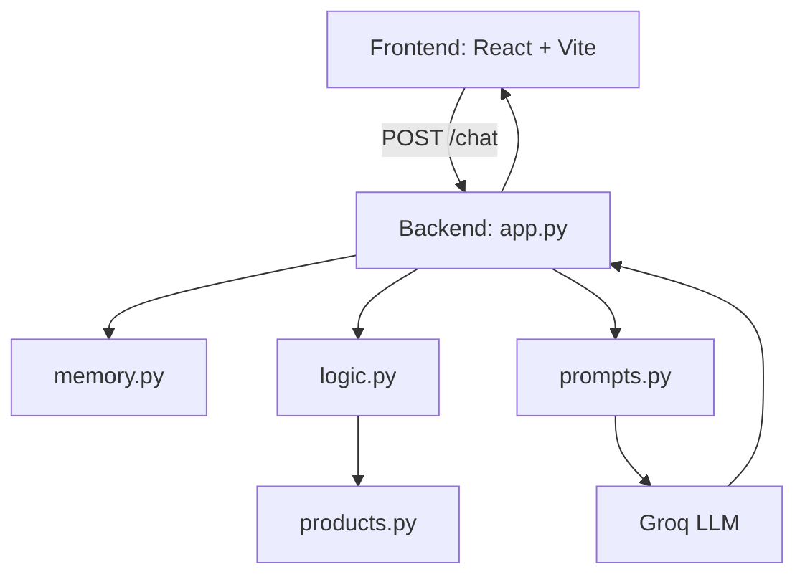
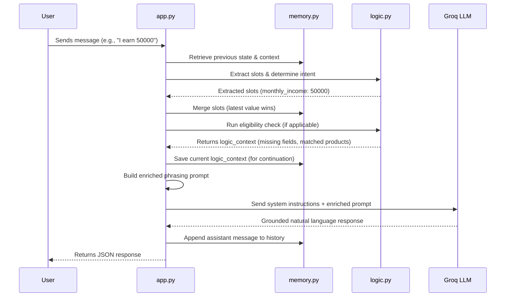
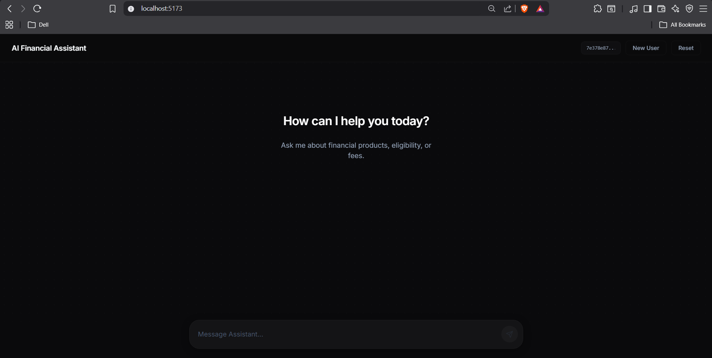
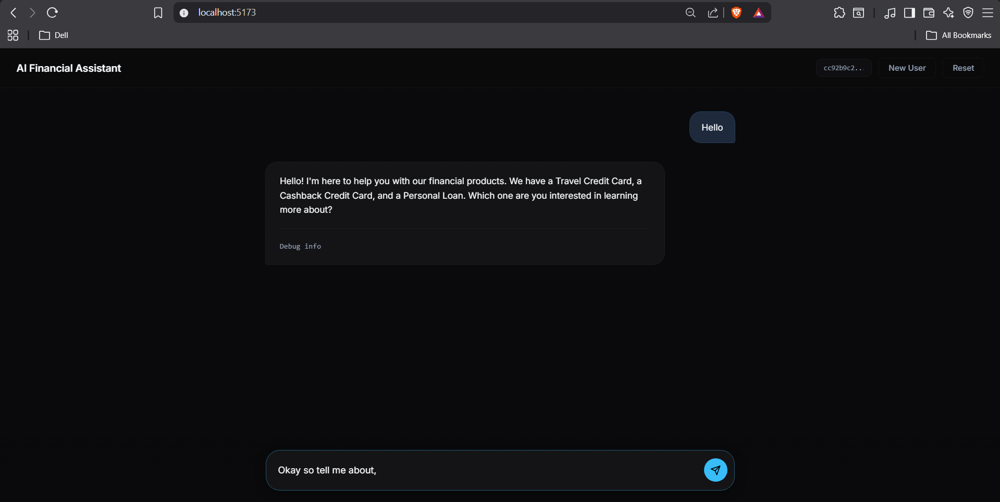
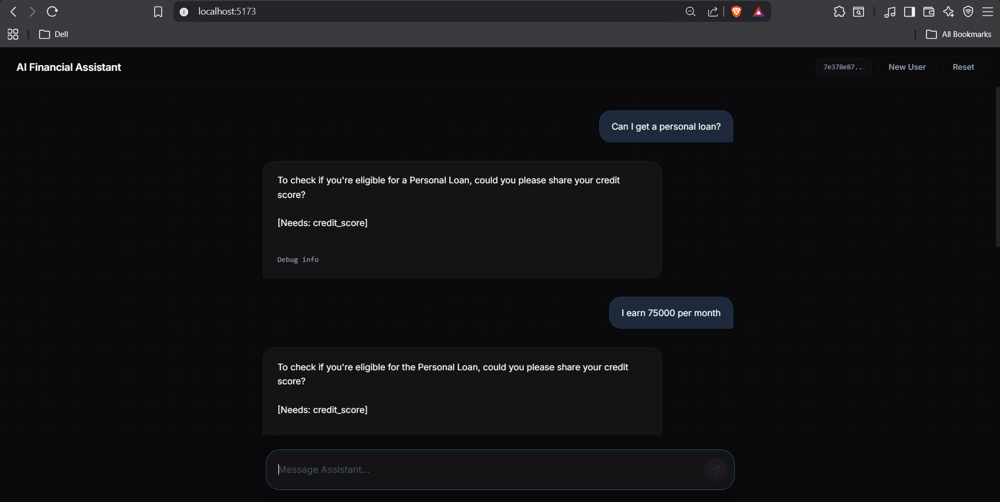
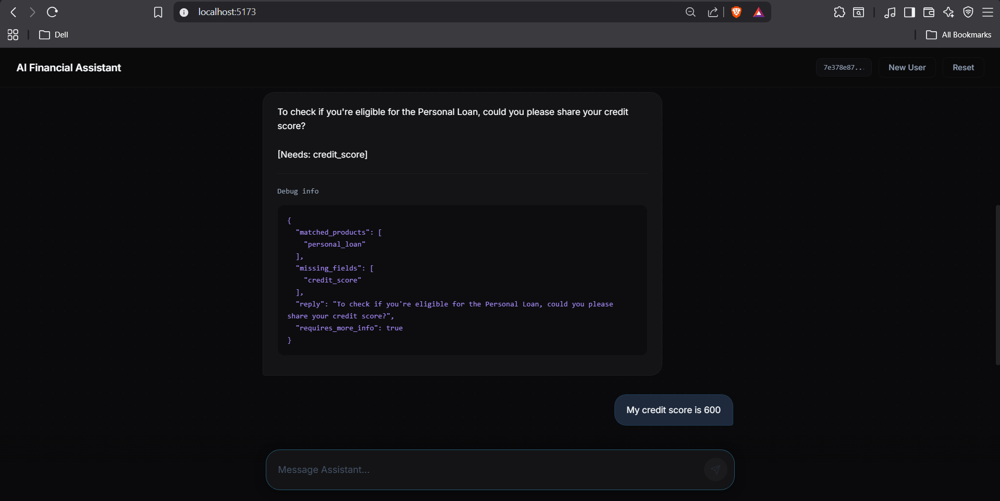
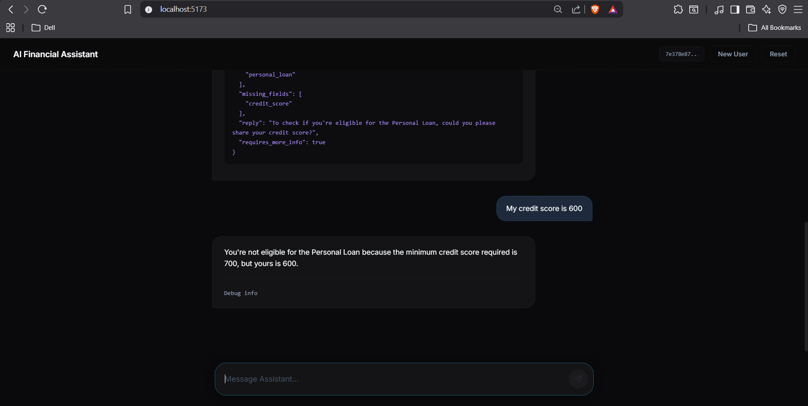
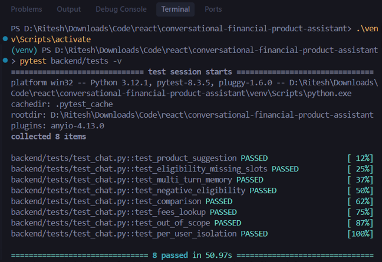

# Smart Financial Assistant

## 1. Overview
This project is a full-stack, AI-powered financial assistant designed to hold multi-turn conversations regarding a fixed set of financial products. It supports dynamic product suggestions, multi-step eligibility checks, deterministic slot filling, and strict NLU grounding. 

The architecture is explicitly designed to maintain absolute per-user isolation, enforce deterministic business rules independently of the Large Language Model (LLM), and leverage the LLM strictly for conversational phrasing and natural language generation.

## 2. Technology Stack & Choices

### Frontend
* **React** (`19.2.x`): Component-based architecture for a highly interactive UI.
* **TypeScript** (`6.0.x`): Strict type safety, eliminating entire classes of runtime errors and ensuring robust API integration.
* **Vite** (`8.0.x`): Next-generation frontend tooling for instantaneous hot module replacement (HMR).
* **Vanilla CSS**: Kept the bundle size minimal by avoiding heavy UI frameworks, relying exclusively on modern CSS features to implement the premium, AI-native aesthetic.

### Backend
* **Python** (`3.11+`): The foundational language, utilized for its clean syntax and AI tooling ecosystem.
* **Flask** (`3.1.0`): A micro-framework perfectly suited for lightweight, decoupled orchestration logic without the overhead of heavy frameworks.
* **Pytest** (`8.3.5`) & **Requests** (`2.32.3`): Used for robust, end-to-end integration testing against a live HTTP server, intentionally avoiding mocks to ensure absolute reliability.
* **Flask-CORS** (`5.0.0`) & **Python-dotenv** (`1.1.0`): Essential middleware for secure cross-origin requests and environment variable management.

### AI & LLM Integration
* **Groq SDK** (`0.28.0`): Chosen for its ultra-low latency inference API.
* **LLM Model**: Integrates the `llama-3.3-70b-versatile` model to provide lightning-fast, highly conversational natural language generation grounded in the deterministic backend logic.

## 3. Architecture Overview
The system is divided into a robust, deterministic Python/Flask backend and a lightweight React/TypeScript frontend.



## 4. System Design Philosophy
A fundamental design decision in this architecture is the strict separation between **deterministic business logic** and **LLM reasoning**.

LLMs are highly prone to hallucinations and non-deterministic behavior, particularly when dealing with hard mathematical constraints or strict eligibility thresholds. To mitigate this risk, the LLM is **not** trusted to evaluate eligibility, remember rules, or determine missing fields. 

Instead:
* `logic.py` acts as a pure, deterministic rules engine. It extracts user slots (age, income, credit score) and evaluates them against the hardcoded constraints in `products.py`.
* The LLM is used strictly as a natural language interface. It is provided with a rigidly formatted context string containing the exact eligibility outcome (e.g., "The user is not eligible because their credit score is 600, and the minimum is 700").
* `prompts.py` ensures the LLM's system prompt strongly enforces grounding, instructing the LLM to only read the provided deterministic context and never invent or override constraints.

This approach guarantees absolute consistency in eligibility decisions, makes the business logic completely unit-testable without relying on expensive and slow LLM calls, and ensures regulatory-level safety.

## 5. Backend Architecture
The backend is structured to isolate responsibilities across specialized modules:

* **`app.py`**: The orchestration layer (Flask API). Manages HTTP requests, invokes the memory and logic layers, handles conversational continuation flows, and communicates with the Groq LLM API.
* **`logic.py`**: The core rules engine. Uses regex-based slot extraction to parse user data, identifies intents, checks eligibility against product constraints, and generates the exact logical context of the conversation.
* **`memory.py`**: An in-memory key-value store mapping `user_id` to conversational state, including past messages, extracted profile slots, and the most recent logic context to enable continuous flows.
* **`prompts.py`**: A prompt generation utility that converts the deterministic output from `logic.py` into strict, grounded instructions for the LLM.
* **`products.py`**: The static dataset containing financial product definitions and eligibility constraints.
* **`tests/test_chat.py`**: End-to-end integration tests that run against the live local server to verify state isolation, context retention, and strict eligibility rule enforcement.

## 6. Conversation & Memory Flow



### Conversational Continuation
The system utilizes a lightweight continuation architecture. If a user was previously asked for missing fields (e.g., "What is your credit score?") and the user replies with raw data ("600"), `app.py` intercepts the flow, merges the new data with the in-memory profile, and re-triggers the specific product eligibility check dynamically, ensuring seamless multi-turn data gathering without losing context.

## 7. Features Implemented

| Feature | Status | Description |
|---|---|---|
| Product Suggestion | Included | Recommends products based on user intent keywords. |
| Eligibility Checks | Included | Evaluates exact profile data against product thresholds. |
| Slot Filling | Included | Extracts age, income, and credit score cumulatively. |
| Multi-turn Memory | Included | Remembers previous profile slots across requests. |
| Negative Eligibility | Included | Gracefully explains exactly why a user failed a check. |
| Comparison | Included | Handles requests comparing multiple distinct products. |
| Fee Lookup | Included | Answers direct queries about product fees accurately. |
| Out-of-Scope Guardrails | Included | Declines to answer queries unrelated to the provided products. |
| Per-user Isolation | Included | Guarantees strict data isolation across concurrent user UUIDs. |
| Debug Panel | Included | Exposes raw backend metadata on the frontend for verification. |
| Integration Tests | Included | Full end-to-end pytest suite verifying requirements. |

## 8. Frontend Overview
The frontend is a single-page application built with React 18, TypeScript, and Vite. 

* **State Persistence**: Uses `localStorage` to persist a unique `user_id` (UUID), ensuring users do not lose their session upon page refresh.
* **UX Mechanics**: Follows modern chat conventions, allowing standard Enter-to-send and Shift+Enter for multiline inputs.
* **Debug Visibility**: Every assistant message dynamically renders a collapsed "Debug info" `<details>` panel. Expanding it reveals the raw JSON metadata returned from the API (matched products, missing fields, etc.), allowing reviewers to explicitly verify the backend logic state independently of the LLM's natural language output.
* **Clean Architecture**: Designed entirely with pure, vanilla CSS to maintain simplicity and avoid unnecessary heavy frameworks or external UI dependencies.

## 9. API Documentation

### POST `/chat`
Submits a user message and retrieves the assistant's response alongside logic metadata.

**Request:**
```json
{
  "user_id": "123e4567-e89b-12d3-a456-426614174000",
  "message": "Am I eligible for the travel card?"
}
```

**Response (200 OK):**
```json
{
  "reply": "To check your eligibility for the Travel Card, could you please share your age and monthly income?",
  "matched_products": ["travel_card"],
  "requires_more_info": true,
  "missing_fields": ["age", "monthly_income"]
}
```

### POST `/reset`
Clears all in-memory profile and conversational history for the specified user.

**Request:**
```json
{
  "user_id": "123e4567-e89b-12d3-a456-426614174000"
}
```

**Response (200 OK):**
```json
{
  "status": "ok"
}
```

### GET `/health`
Simple health check endpoint.

**Response (200 OK):**
```json
{
  "status": "ok"
}
```

## 10. Testing
The project includes a robust suite of integration tests built with `pytest`. 
These tests execute live HTTP requests against the running Flask backend. Mocks are intentionally avoided to ensure the actual end-to-end integration (including prompt building, LLM execution, and JSON parsing) functions correctly.

All 8 scenarios described in the assignment are fully covered, including product matching, multi-turn state retention, and strict user isolation. 

*(See Screenshots Section for test execution results)*

## 11. Running the Project

### Prerequisites

* Python 3.11+
* Node.js 18+
* npm
* A valid Groq API key

---

## Option A — Standard Manual Startup (Recommended)

### Backend Setup

```bash
# 1. Create and activate a virtual environment
python -m venv venv

# Windows
.\venv\Scripts\activate

# Mac/Linux
source venv/bin/activate

# 2. Install backend dependencies
pip install -r backend/requirements.txt

# 3. Start the Flask backend (runs on port 5000)
python -m backend.app
```

### Frontend Setup

Open a second terminal:

```bash
# 1. Navigate to frontend directory
cd frontend

# 2. Install frontend dependencies
npm install

# 3. Start the Vite development server
npm run dev
```

The frontend will typically run on:

```txt
http://localhost:5173
```

---

## Option B — One-Command Startup (Windows Convenience Script)

For easier local development on Windows, the project also includes a helper script that launches both the backend and frontend automatically in separate terminals.

From the project root:

```powershell
powershell -ExecutionPolicy Bypass -File .\start.ps1
```

This will automatically:

* launch the Flask backend on port 5000
* launch the Vite frontend on port 5173

---

## Running Tests

Ensure the backend server is actively running on `localhost:5000`, then execute:

```bash
pytest backend/tests -v
```


## 12. Environment Variables
The backend requires a `.env` file at the root of the project. A `.env.example` file is provided for reference.

```env
GROQ_API_KEY=your_groq_api_key_here
```

## 13. Assumptions
* **In-Memory Storage**: An in-memory dictionary is sufficient for maintaining conversational state within the scope of this assignment. 
* **Single Process Runtime**: The backend is intended to run as a single process for local development. In-memory state would not sync automatically across multiple load-balanced workers without an external datastore like Redis.
* **Localhost Environment**: Vite proxies API requests directly to `http://localhost:5000`, assuming local development defaults.

## 14. Known Limitations
* **Ephemeral Memory**: All user profiles and chat histories are lost when the Flask server restarts.
* **Slot Extraction**: The extraction relies on RegEx patterns. While sufficient for common conversational patterns, highly unconventional phrasings (e.g., "my income translates to 50k a month") might fail to match.
* **Authentication**: There is no secure authentication. User IDs are dynamically generated client-side UUIDs.

## 15. What I Would Improve With More Time
* **Persistent Storage**: Implement Redis or PostgreSQL to persist user profiles and chat logs permanently.
* **Structured Tool Calling**: Replace RegEx-based slot extraction with native LLM function/tool calling (e.g., OpenAI/Groq function definitions) for significantly more robust intent and entity extraction.
* **Streaming Responses**: Implement Server-Sent Events (SSE) on the backend and frontend to stream tokens back to the user, improving perceived latency.
* **Dockerization**: Provide a `docker-compose.yml` file to spin up the frontend and backend simultaneously in isolated containers.
* **Semantic Retrieval (RAG)**: If the product catalog expanded, I would implement a vector database for semantic search rather than relying on keyword matching.
* **Voice-Based Interface**: Integrate a speech-to-text (STT) model like Whisper alongside an efficient text-to-speech (TTS) engine to create a completely hands-free, voice-first financial conversational experience.

## 16. AI Tooling Disclosure
Used ChatGPT during the initial stages for requirement analysis, architectural planning, optimization discussions and implementation guidance.   
Used Claude for generating structured development plans, workflow breakdowns and directional guidance throughout development.    
Followed and manually executed these plans step-by-step for setup, integration, configuration and implementation tasks.   
Used Antigravity to accelerate repetitive engineering work, larger boilerplate generation, UI refinements and logic scaffolding.    
AI-generated outputs were consistently reviewed, modified, cross-validated and manually integrated rather than directly copied into production.   
Core architectural decisions, optimization strategies, debugging, testing, and final verification were deliberately handled through manual engineering effort to ensure correctness, maintainability and reliability.     

## 17. Repository Structure
```
.
├── backend/
│   ├── tests/
│   │   └── test_chat.py
│   ├── app.py
│   ├── logic.py
│   ├── memory.py
│   ├── products.py
│   ├── prompts.py
│   └── requirements.txt
├── frontend/
│   ├── src/
│   │   ├── types/
│   │   │   └── index.ts
│   │   ├── api.ts
│   │   ├── App.css
│   │   ├── App.tsx
│   │   ├── index.css
│   │   ├── main.tsx
│   │   └── vite-env.d.ts
│   ├── index.html
│   ├── package.json
│   ├── tsconfig.json
│   └── vite.config.ts
├── docs/
│   └── screenshots/
├── .env.example
├── .gitignore
└── README.md
```

## 18. Screenshots Section


### Chat Example






### Tests Passed
